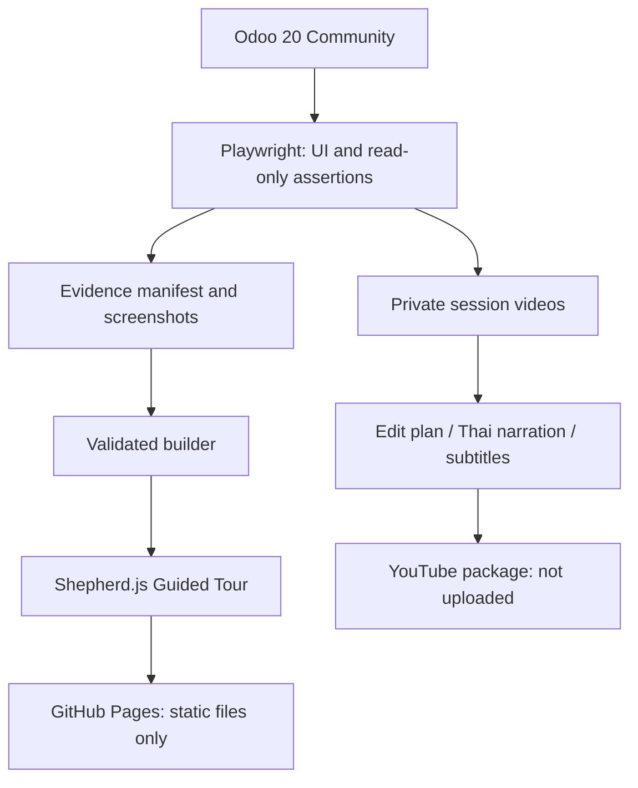

# GovOpsDev ERP

GovOpsDev ERP เป็น baseline โอเพนซอร์สสำหรับ ERP ภายในองค์กรภาครัฐ ปรับย้ายจาก [NSTDA ERP-Government](https://github.com/NSTDA/ERP-Government) สู่ Odoo 20 Community พร้อมภาษาไทย คู่มือ HTML และหลักฐานสาธิตจากระบบจริง

## What this project is

ชุดซอร์สรวมโมดูลเจ็ดโดเมนใน repository เดียว ใช้ Project และแอปมาตรฐาน Odoo ร่วมกับส่วนขยายงบประมาณ หน่วยงาน และกระบวนการภาครัฐ ไม่ต้องใช้ Git submodules เริ่มใช้งานจากเมนูแอปปกติ ไม่มีหน้าพิเศษที่ใช้แทน workflow จริง

## Migration status

| ขอบเขต | สถานะ |
|---|---|
| Source migration ของโมดูลที่เลือก | **COMPLETE** ตาม [รายงานปิด migration](docs/migration-closure-report.md) |
| Reference / greenfield production-readiness validation | **PASS** ตาม [ขอบเขตการตรวจรับ](docs/production-readiness.md) |
| Fresh Creation demo และ Guided Tour | **PASS** — [ผลทดสอบ](docs/fresh-creation-validation.md) |
| Production deployment ของหน่วยงาน | **ไม่รวมใน repository/demo นี้** |

ผลทดสอบครอบคลุมสภาพแวดล้อมอ้างอิงและข้อมูลสังเคราะห์ ไม่ใช่การรับรอง production ทุกองค์กร ไม่ได้แปลงฐานข้อมูล production เดิมที่ไม่ได้รับมา การนำไปใช้ต้องตั้งค่าข้อมูลจริง นโยบายบัญชี/ภาษี การเชื่อมต่อ ขนาดระบบ และทดสอบรับมอบตามบริบทของหน่วยงาน

## Demonstrations

[เปิดตัวเล่น Guided Tour](guided-tour/) · [ความโปร่งใสของหลักฐาน](docs/demo-evidence.md) · [วิธีเตรียม GitHub Pages](docs/github-pages.md)

ลิงก์ด้านบนเป็นเส้นทางใน repository; บน GitHub ให้ใช้ Pages หลังเปิดเผยแพร่ รูปแบบ URL คือ `https://<owner>.github.io/<repo>/guided-tour/` ยังไม่อ้างว่า Pages เปิดใช้งานแล้ว

### Quick Guided Tour

เปิดดูธุรกรรม PROJECT70 ที่บันทึกไว้จริง พร้อมผลสรุปงบ ใช้ภาพและ metadata ชุดเดิม ไม่สร้างรายการใหม่

### Full Creation Tour

27 checkpoints จาก Playwright ที่สร้างโครงการและเอกสารใหม่ผ่าน Odoo UI จริง ผู้ใช้เลือก **Full Creation Tour · สร้างใหม่** ในตัวเล่น

### Dashboard BI Tour

สำรวจภาพ Dashboard งบประมาณจริงและผลการเปลี่ยนตัวกรองโครงการ/หน่วยงานผ่าน Guided Tour แบบภาพบันทึก

### Video Demo

> **Video coming soon** — มีชุดตัดต่อ บทบรรยายไทย คำบรรยาย SRT/VTT และ chapter markers พร้อมแล้ว ยังไม่มี YouTube ID หรือวิดีโอเผยแพร่

หลัง upload ให้แทนบล็อกนี้ด้วย thumbnail-link ของวิดีโอจริงตาม [คู่มือแพ็กเกจวิดีโอ](video/README.md) ไม่ใช้ลิงก์หรือ thumbnail ที่เดา ID ขึ้นมา

### Live Odoo Demo

Live Odoo Demo เปิดเฉพาะช่วงทดสอบ/สาธิตที่นัดหมายและใช้บัญชีตามสิทธิ์ที่เตรียมไว้ เว็บไซต์ Pages เป็นตัวเล่นภาพหลักฐาน ไม่ใช่ Odoo และไม่สลับ login จริงตาม persona ในภาพ ไม่มี temporary tunnel หรือข้อมูลเข้าสู่ระบบในชุดเผยแพร่

## Full Creation Scenario

ข้อมูลจำลองของ **สำนักงาน A สูงสุด**:

Project → Budget → Purchase Request → Requisition → Purchase Order → Agreement → Work Acceptance → Stock Receipt → Vendor Bill → Finance Actual → Asset → Final Project/Budget Result

| ผลตรวจ | ค่า |
|---|---:|
| วงเงิน | 300,000 THB |
| ใช้จริงก่อนภาษี | 180,000 THB |
| คงเหลือ | 120,000 THB |
| ภาระผูกพันสุดท้าย | 0 THB |
| สั่งซื้อ / ตรวจรับ / รับเข้า / ตั้งหนี้ | 6 เครื่องเท่ากัน |
| ครุภัณฑ์ | AST/00303–00308 รวม 180,000 THB |

บิลรวม VAT 192,600 THB; policy งบใช้ยอดก่อนภาษี งานเสร็จและ milestone บรรลุแล้ว โครงการยังเปิดติดตาม ครุภัณฑ์/รายการค่าเสื่อมยังเป็นร่าง ไม่มีการจ่ายเงินหรือลงค่าเสื่อมใน scenario นี้

## Migrated Domains

| Domain | ความสามารถหลัก |
|---|---|
| Organization | หน่วยงาน ลำดับชั้น การมอบหมาย บทบาท และ HR |
| Budget | แผน จัดสรร KPI วงเงิน ผูกพัน ใช้จริง การปรับปรุง และ [Project Budget BI](docs/budget-dashboard.md) |
| Procurement | PR วิธีจัดซื้อ ลำดับอนุมัติ requisition และ PO |
| Finance & Accounting | บิล รายจ่าย เงินยืม เงินมัดจำ และยอดใช้จริง |
| Agreement & Contract | ข้อตกลง กฎหมาย ประวัติฉบับ สัญญา และหลักประกัน |
| Inventory / Work Acceptance | ตรวจรับ รับเข้า เบิก โอน คืน และยอดคลัง |
| Asset | การได้มา ค่าเสื่อม ระหว่างก่อสร้าง โอน และจำหน่าย |

มีคำแปลภาษาไทยและ [คู่มือ HTML ใน 15 แอป](docs/user-manuals.md) บริษัทใหม่ใช้ [THB เป็นค่าเริ่มต้น](docs/thb-defaults.md) โดยไม่เปลี่ยนประวัติ USD เดิม

## Architecture



`shared/erp_core/` เก็บพื้นฐานร่วม; `projects/` เก็บเจ็ดโดเมน; `ops/readiness/` เก็บเครื่องมือ deployment/backup; `playwright-demo/` เก็บ recorder; `guided-tour/` เก็บตัวเล่นและหลักฐานที่ตรวจแล้ว; `video/` เก็บเอกสารตัดต่อ ดู [สถาปัตยกรรม](docs/odoo20-target-architecture.md)

## How the demo evidence is generated

Full Creation run `FRESH70-20261101T105234882Z` ใช้ UI จริงบนฐาน restore แยก พร้อมผู้ตรวจทานงบอีกบัญชี การอ่าน RPC ตรวจ FK ยอดและสถานะ; ไม่ใช้ ORM/SQL เขียนธุรกรรมแทนการคลิก Builder ตรวจ hashes, reconciliation และการตรวจข้อมูลก่อนเผยแพร่ แล้วแยกผล Quick/Permission กับ Full Creation คนละ directory

ภาพไม่ถูกวาดเลียนแบบ Odoo Raw video, trace, DB และ secrets ไม่อยู่ใน Git/Pages ดู [evidence pipeline](docs/demo-evidence.md) และ [public-safety audit](docs/public-release-audit.md)

## Run locally

ใช้ Docker/Compose ตาม [runbook](docs/production-readiness-runbook.md) และ image ที่ตรึงใน [release manifest](docs/release-manifest.md) ไม่ใช้ `latest` โดยอัตโนมัติ เตรียม secrets ภายนอก repository และใช้ secrets เดิมหากมี volume อยู่แล้ว

```bash
export ERP_DATABASE=erp_readiness
export ERP_SECRETS_DIR=/absolute/path/outside/repository/secrets
python3 ops/readiness/stack.py --secrets-dir "$ERP_SECRETS_DIR" -- up -d db
python3 ops/readiness/stack.py --secrets-dir "$ERP_SECRETS_DIR" -- \
  run --rm -T app -d "$ERP_DATABASE" -i erp_user_manual,erp_dashboard_th,project \
  --stop-after-init --workers=0 --no-http
python3 ops/readiness/stack.py --secrets-dir "$ERP_SECRETS_DIR" -- up -d app proxy
```

ติดตั้ง `project` ชัดเจนเพื่อให้ได้แอป Project แม้ใช้ baseline คู่มือรุ่นเดิม กำหนดบริษัท บัญชีวิเคราะห์ หน่วยงาน ผู้ใช้และ tiers ผ่านเมนูปกติก่อนสร้างเอกสาร คำสั่งนี้ไม่สร้างบัญชีสาธิตหรือข้อมูลธุรกิจของ Full Creation ให้เอง

สำหรับ static demo เท่านั้น:

```bash
python3 scripts/check-public-release.py
python3 scripts/build-pages.py
python3 -m http.server 8080 --bind 127.0.0.1 --directory _site
```

เปิดพอร์ต 8080 บนเครื่องทดสอบแล้วเลือก Guided Tour ไม่ต้องมี Odoo สำหรับการเล่นภาพ ดู [Pages validation](docs/github-pages.md) สำหรับการตรวจใต้ nested path

## Source / provenance

ต้นทาง [NSTDA ERP-Government](https://github.com/NSTDA/ERP-Government) commit `5a1722c4c6f6cfdf3ed59362a56e85777c58a383` เป็นฐาน Odoo 15 ก่อน migration สู่ Odoo 20 ขอบคุณ NSTDA, Odoo, OCA, Ecosoft และผู้พัฒนาที่ระบุในแต่ละส่วนประกอบ ดู [provenance](docs/provenance.md), [source snapshot](docs/source-snapshot.json), [mapping](docs/source-mapping.md) และ [NOTICE](NOTICE.md)

## License

โครงการและโมดูล ERP ใช้ [AGPL-3.0](LICENSE) ส่วนประกอบภายนอกคง license/credit ของตนเอง Odoo Community เป็น LGPL-3.0; Shepherd.js 15.2.3 มี [license ต้นฉบับที่แนบไว้](guided-tour/assets/vendor/SHEPHERD-LICENSE.md) ดู [inventory](docs/provenance.md) ก่อนนำส่วนประกอบไปใช้ในบริบทอื่น

## Disclaimer

This repository is an independent Odoo 20 Community migration and demonstration based on the open-source NSTDA ERP-Government project. It is not an official NSTDA release.

การสาธิตใช้ข้อมูลจำลอง ไม่มีการรับรองหรือสนับสนุนอย่างเป็นทางการจาก NSTDA และไม่ใช่ระบบ production ของหน่วยงาน ตัวชุด showcase นี้เตรียมเป็น `demo-v1.0.0-rc1`; ดู [release notes](docs/release-notes-rc1.md)
